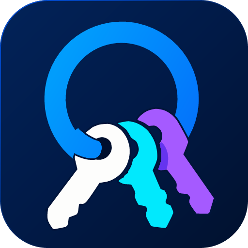
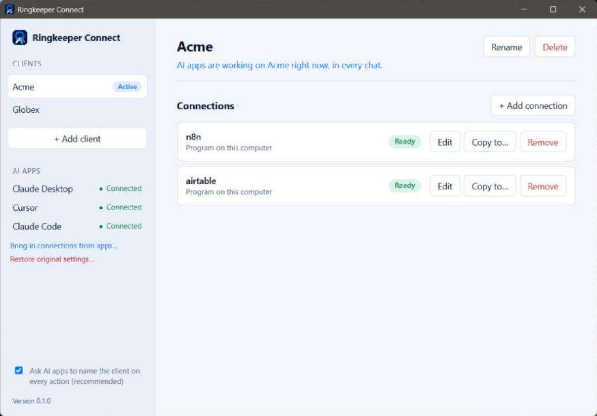
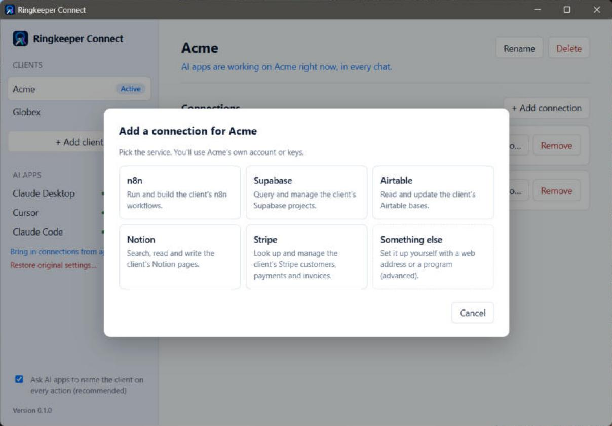
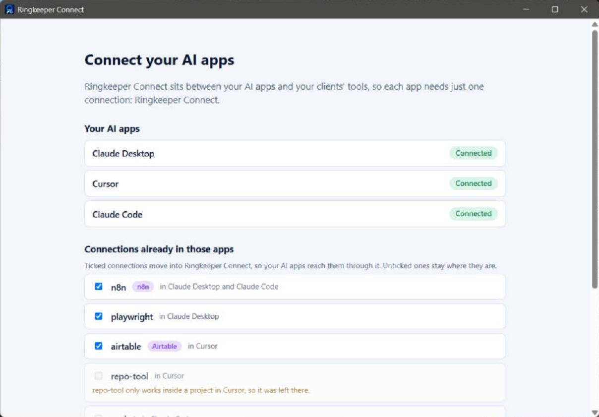
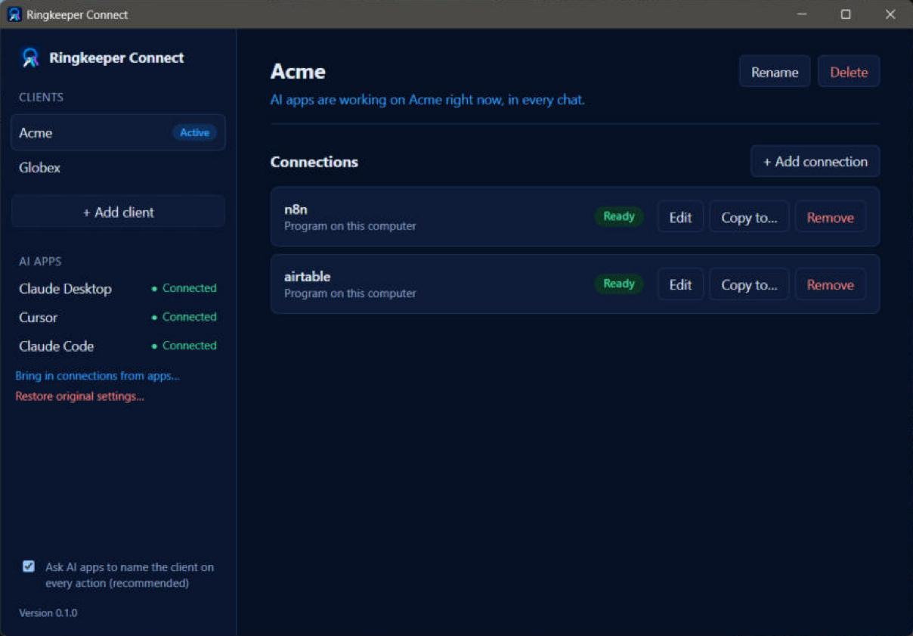

<p align="center">
  
</p>

# Ringkeeper Connect

**Connect each client's tools once, and never switch again, even across 100 clients.**

If you run an agency, every client has their own n8n, Airtable, Notion or Stripe. Normally that means editing your AI apps' settings and swapping keys whenever you move from one client to the next. With Ringkeeper Connect you add each client's tools once. Claude Desktop, Cursor and Claude Code then see a single connection, Ringkeeper Connect, which always points at the client you're working on.

- **Pick the client, not the settings.** Switch clients from the tray or the menu bar, or just ask the AI ("work on Globex now").
- **The right account, every time.** Every action the AI takes is labelled with the client it ran against. Ringkeeper refuses anything aimed at a different client than the one you're working on.
- **No terminal, ever.** Everything happens in the app. Ringkeeper ships with everything it needs to run, so you don't install Node, Python or Docker.
- **Your keys stay yours.** Keys and sign-ins are stored encrypted by your computer's own secure storage, and never shown again.
- **Nothing to lose.** Ringkeeper backs up your AI apps' settings before changing them. "Restore original settings" (or uninstalling) puts everything back.

## Install

1. Download the installer for your computer from the [latest release](https://github.com/alexyushkin/ringkeeper-connect/releases/latest):
   - **Windows:** `Ringkeeper-Connect-Setup-<version>.exe`
   - **Mac with Apple silicon (M1 and later):** `Ringkeeper-Connect-<version>-arm64.dmg`
   - **Mac with Intel:** `Ringkeeper-Connect-<version>-x64.dmg`
2. Open it. On Windows it installs and starts by itself. On a Mac, drag Ringkeeper Connect into Applications and open it.
3. Ringkeeper finds Claude Desktop, Cursor and Claude Code on your computer and shows the connections already set up in them. Choose which to bring in and click **Connect apps**.
4. Restart Claude Desktop (and Cursor, if it's open). That's it.

To add a client, click **Add client**, then **Add connection** and pick the service: n8n, Supabase, Airtable, Notion or Stripe. For most services you just sign in with the client's account. For the others, each key comes with a link to where to find it.

Ringkeeper Connect updates itself.

## Screenshots

| Your clients | Adding a client's tools |
| --- | --- |
|  |  |
| **Connecting your AI apps** | **Dark mode** |
|  |  |

## Need help setting it up for your clients?

Get in touch at <https://yushkin.us> or on [LinkedIn](https://www.linkedin.com/in/alexey-yushkin).

---

## How it works (for the curious)

- Ringkeeper Connect runs quietly in the tray (Windows) or menu bar (macOS). Each AI app gets one entry in its own settings that points at Ringkeeper. Behind it, Ringkeeper starts the active client's connections and passes the AI's requests through.
- AI apps that can refresh their tool list (Claude Code, Cursor) see the active client's tools directly. Claude Desktop, which loads its tools only at startup, gets four fixed tools: list clients, switch client, find a tool, run a tool.
- When it edits an AI app's settings, Ringkeeper changes only that app's list of connections. Every other setting stays exactly as it was, and each change is backed up first.
- Details and decisions are in [docs/SPEC.md](docs/SPEC.md) and the milestone write-ups in [docs/](docs/).

## Building from source

Requires Node 24 and pnpm (via `corepack enable`).

```bash
pnpm install
```

```bash
node scripts/fetch-runtimes.mjs
```

```bash
pnpm test
```

```bash
pnpm desktop
```

- `node scripts/fetch-runtimes.mjs` downloads the Node and uv builds the app ships with, and checks them against pinned checksums.
- `pnpm desktop` starts the app. While developing, set `RINGKEEPER_FAKE_HOME` and `RINGKEEPER_DATA_DIR` so you never touch your own AI apps' settings; see [spike/README.md](spike/README.md).
- `pnpm package:desktop` builds an installer. Releases are built by GitHub Actions when a `v*` tag is pushed. They're signed when the signing secrets are configured (see [`.github/workflows/release.yml`](.github/workflows/release.yml)), and unsigned otherwise.

## License

[MIT](LICENSE) © 2026 Alexey Yushkin
